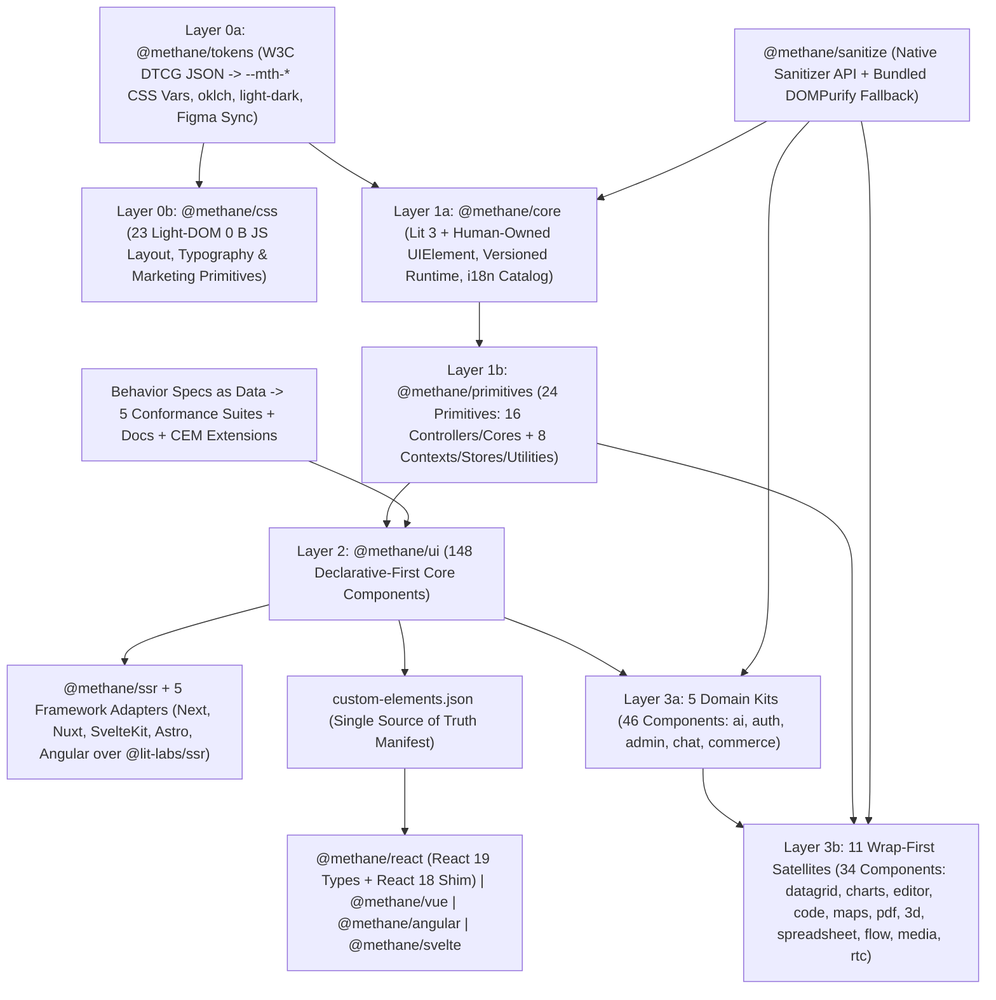

# Methane (`@methane/*`): Complete End-to-End Architecture & Execution Plan

**Methane** (`@methane/*` packages, `<mth-*>` custom elements, `--mth-*` CSS custom properties, `.mth-*` CSS primitives) achieves ~250+ UI capabilities without collapsing under its own weight via a **strictly layered, spec-first architecture**:
- **Layer 0 (`@methane/tokens`, `@methane/css`):** **23 Light-DOM CSS primitives** (0 B JS) for layout, typography, and static marketing blocks.
- **Layer 1 (`@methane/sanitize`, `@methane/core`, `@methane/primitives`):** **Lit 3** wrapped in a thin, human-owned `UIElement` base class, a single versioned global runtime (`globalThis[Symbol.for('@methane/runtime')]`), built-in i18n message catalogs, and **24 shared primitives** (16 controllers/cores + 8 contexts/stores/utilities).
- **Layer 2 (`@methane/ui`):** **148 declarative-first, tree-shakeable custom-element entrypoints** (`4` Phase 0 + `30` Phase 1 + `114` Phase 2).
- **Layer 3a (`@methane/{ai,auth,admin,chat,commerce}`):** **46 domain kit components** (`8` Phase 3 + `38` Phase 4) composing public `@methane/ui` + `@methane/primitives`.
- **Layer 3b (11 Wrap-First Satellites):** **34 heavy component entrypoints** (including all 19 chart types) wrapping best-of-breed permissive engines (`Phase 5`).



---

## 1. Architectural Thesis & Runtime Foundation

> [!IMPORTANT]
> **Rule #1 — Earned Shadow DOM:** Only attach a Shadow Root and register a Custom Element when a component owns encapsulated state, ARIA/focus coordination, form participation, or an imperative lifecycle. Purely structural, typographical, and static marketing blocks ship in `@methane/css` as **0 B JS Light-DOM CSS primitives** so CSS Subgrid, Flexbox, margin behavior, and zero-hydration SSR work without runtime overhead.

### Core Technical Architecture
- **Naming & Prefix Standard [ADR-015]:**
  - Packages: `@methane/*`. Default tag prefix: `mth-` (`<mth-button>`, `<mth-combobox>`), configurable via `defineComponents({ prefix })`. CSS tokens: `--mth-*` (private `:host` aliases `--_*`). Custom events: `mth-*` (`mth-open`, `mth-after-open`, `mth-close`, `mth-after-close`; native `input` and `change` stay unprefixed).
- **Lit 3 + Thin Human-Owned `UIElement` (`@methane/core`) [ADR-001]:**
  - Uses **Lit 3 (`lit`)** as the reactive template and `CSSStyleSheet` adoption layer.
  - Wraps `LitElement` in a thin, **human-owned `UIElement` base class** backed by **`fast-check` property-based tests** exercising arbitrary sequences of attribute/property mutations, DOM connect/disconnect/move cycles, form callbacks, and SSR hydration states.
  - `UIElement` adds five capabilities only: (1) Declarative Shadow DOM (DSD) in-place hydration hooks, (2) Form-Associated Custom Element (FACE) `ElementInternals` wiring, (3) `CustomStateSet` (`:state()`) helpers, (4) reactive i18n message-catalog lookup, and (5) tree-shakable `__DEV__` diagnostics.
  - Every component exports both an **auto-registering entrypoint** (`@methane/ui/combobox`) and a **side-effect-free class entrypoint** (`@methane/ui/combobox/element.js`).
  - **Never use customized built-in elements** (`extends HTMLButtonElement` / `is="..."`)—Safari permanently declined to ship them.
- **Single Versioned Runtime & Skew Protection (`globalThis[Symbol.for('@methane/runtime')]`) [ADR-007]:**
  - Zero module-level singletons. All cross-component coordinators—**top-layer/overlay stack, `NotificationStore`, `HotkeyManager`, `LiveAnnouncer`, `registerStyles` sheet registry, pooled `ResizeObserver`/`IntersectionObserver` instances, and tag-prefix registry**—live on `globalThis[Symbol.for('@methane/runtime')]`.
  - **SemVer Negotiation & Duplicate-Core Guard:** On boot, `@methane/core` negotiates with any existing runtime record; within the same major version, the highest semver wins and upgrades shared coordinators in place while emitting a `__DEV__` duplicate-bundle warning. `@methane/ui` and all kits peer-depend on the same `@methane/core` major (`^1.0.0`), using capability checks (`runtime.capabilities`) to tolerate minor skew.
- **Browser Baseline Policy & Dual-Path Progressive Enhancement [ADR-010]:**
  - Core targets **Baseline Widely Available**. Every newer API is gated behind feature detection with a complete fallback, and **CI executes tests on both the native path and the forced-fallback path**:

| Progressive Enhancement | Feature Detection | Mandatory Fallback Path |
| :--- | :--- | :--- |
| Customizable `<select>` (`appearance: base-select`) | `CSS.supports('appearance', 'base-select')` | Custom `[popover]` + `ListboxController` (or native OS `<select>` in `native` mode) |
| CSS Anchor Positioning (`position-area` / `anchor()`) | `CSS.supports('position-area', 'block-end')` | Full JS `PositioningController` (collision `flip`, cross-axis `shift`, scroll parents, `ResizeObserver`, `visualViewport`, virtual `DOMRect` anchors) |
| Carousel `::scroll-button()` / `::scroll-marker()` | `CSS.supports('selector(::scroll-button(*))')` | Accessible shadow `<button>` prev/next & pagination controls over CSS `scroll-snap` |
| Tooltip / Hovercard `interestfor` | `'interestForElement' in HTMLButtonElement.prototype` | Hover/focus/touch-long-press intent timers + Escape dismissal |
| Invoker Commands (`commandfor` / `command`) | `'commandForElement' in HTMLButtonElement.prototype` | Event delegation + explicit `aria-expanded` / dialog toggle wiring |
| `Node.prototype.moveBefore()` | `'moveBefore' in Element.prototype` | Controller state snapshot across standard `insertBefore` reconnect |
| `EyeDropper` API | `'EyeDropper' in window` | Hides eyedropper trigger cleanly; retains full canvas/input OKLCH/HEX picker |
| Custom Element Scoped Registries | `'createElement' in ShadowRoot.prototype` | Configurable tag-prefix registration (`defineComponents({ prefix })`) |
| HTML Sanitizer API (`Element.prototype.setHTML`) | `'setHTML' in Element.prototype` | Bundled DOMPurify sanitizer in `@methane/sanitize` with parity flags |

- **Built-In i18n Message Catalog & Zero-Bundle Locale Formatting [ADR-011]:**
  - `@methane/core` includes a message-catalog system: default English (`en`) strings are co-located and tree-shakably inlined per component, overridable via **Locale Context**, per-instance props/slots, or lazy-loaded locale packs (`@methane/locales/<locale>.js`).
  - Supports `Intl.PluralRules` plural forms, RTL-safe Unicode bidi isolation (`\u2068…\u2069`) around interpolated values, and routes **all** built-in labels, validation errors, empty states, and `LiveAnnouncer` speech through the catalog.
  - Date, number, currency, and relative-time formatting uses native `Intl.*` and `Temporal` (with `Date` fallback).

---

## 2. Solving the Highest-Leverage Pillars

### Pillar A: Hybrid DSD Style Delivery, `@lit-labs/ssr` & Framework Adapters
1. **Streaming SSR Engine (`@methane/ssr`) [ADR-001]:**
   - Wraps `@lit-labs/ssr` behind our stable streaming API (`renderToStream`, `renderToString`) and `@lit-labs/ssr-client` on hydration. Build a custom string renderer behind `@methane/ssr` *only if* `@lit-labs/ssr` fails the Hydration Purity Test.
2. **Hybrid DSD Style Delivery (`<link>` + Critical Inline Shell) [ADR-008]:**
   - **Default mode:** Each `<template shadowrootmode="open">` emits a content-hashed `<link rel="stylesheet" href="...">` (HTTP-cached and parsed **once per URL** across repeated instances) paired with a **< 1 KB inlined `<style>` critical shell** defining `:host` display, box-sizing, and layout bounds to guarantee zero FOUC and zero CLS.
   - **`inline` mode:** Inlines the full component stylesheet inside `<style>` for emails, single-file HTML exports, and assetless edge responses.
   - **Roadmap hook:** Adopt declarative `adoptedStyleSheets` once Baseline Widely Available.
   - Client-only pages without SSR use a **fail-open `:not(:defined)` opacity animation** (`animation: mth-defined-fallback 0.2s 2s forwards`) rather than `visibility: hidden`.
3. **Six Explicit SSR Adapter Deliverables [ADR-009]:**
   - `@methane/ssr` (generic Node / Bun / Deno / WinterCG Edge `TransformStream` pipeline)
   - `@methane/ssr-next` (Next.js App Router, React Server Components + React 19 native custom elements)
   - `@methane/ssr-nuxt` (Nuxt Nitro server plugin + Vue SSR custom-element config)
   - `@methane/ssr-sveltekit` (SvelteKit server `handle` transform + client hydration)
   - `@methane/ssr-astro` (Astro server renderer integration + `<link>` stylesheet asset hoisting)
   - `@methane/ssr-angular` (Angular SSR server serialization + non-destructive client upgrade)

### Pillar B: 4-Tier Styling That Never Fights Shadow DOM
| Tier | Mechanism | Contract & SemVer Guarantees |
| :--- | :--- | :--- |
| **1. Design Tokens** | CSS Custom Properties (`--mth-*`) | W3C DTCG JSON compiled to CSS variables using `light-dark()` and `oklch()` relative color syntax (`oklch(from var(--mth-accent) calc(l - 0.08) c h)`). **Public `--mth-*` tokens are never seeded on `:host`**; `:host` aliases them into private `--_*` variables. **`:host-context()` is banned.** Covered by SemVer. |
| **2. Parts & States** | `::part()` + `exportparts` + `:state()` | Stable semantic parts (`base`, `control`, `label`, `hint`, `error`, `prefix`, `suffix`, `popup`) + `CustomStateSet` (`:state(open)`, `:state(loading)`, `:state(user-invalid)`). Covered by SemVer. |
| **3. Sheet Escape Hatch** | `registerStyles(tagOrGlobal, css)` | Appends Constructable `CSSStyleSheet` rules into `@layer override` via `@methane/runtime`. **SemVer rule:** Selectors targeting internal shadow nodes not exposed as `::part()` are **internal and SemVer-exempt**. |
| **4. Unstyled / Primitives** | Base Theme Sheet + `@methane/primitives` | Swap the default aesthetic theme for the minimal structural sheet or attach controllers directly to custom elements. |

- **Container-Responsive & Logical CSS Only:** Interactive layout shifts use `container-type: inline-size` on explicit block hosts, and 100% of stylesheets enforce CSS Logical Properties (`padding-inline`, `inset-inline-start`) + `--mth-density` scaling (`compact`, `default`, `comfortable`).

### Pillar C: Same-Root ARIA, FACE Form Integration & Autofill Reality
1. **Strict Same-Root ARIA Contract [ADR-003]:**
   - **Every `aria-*` ID reference (`aria-labelledby`, `aria-describedby`, `aria-errormessage`, `aria-controls`, `aria-activedescendant`) must resolve within the exact same DOM root.**
   - Every control renders its own `<label>`, hint, and error containers **inside its Shadow Root**, populated via `label`, `hint`, and `error` props/attributes **plus** `slot="label"`, `slot="hint"`, and `slot="error"` (slotted Light DOM text is mirrored into internal shadow nodes so accessible names/descriptions always resolve inside the shadow root).
   - External `<label for="id">` works natively via `ElementInternals.labels`.
   - `<mth-field>` is purely a **layout wrapper and Community Context Protocol provider** passing `label`, `hint`, `error`, `required`, and `disabled` down to its child control—**never** a cross-root ARIA bridge.
   - `ariaLabelledByElements` / `ariaDescribedByElements` and Reference Target are used strictly as optional progressive enhancements.
2. **Form-Associated Custom Elements (`FormControlController`):**
   - `static formAssociated = true` with `setFormValue(value | FormData)`, `setValidity(flags, localizedMessage, focusAnchor)`, `formResetCallback()`, `formStateRestoreCallback()`, and `:state(dirty | touched | user-invalid)`.
   - **Critical `fieldset[disabled]` Rule:** `formDisabledCallback(disabled)` disables internal shadow controls without ever mutating the host's `disabled` attribute.
   - **Autofill & Password-Manager Bridge:** Autofill-targeted inputs (`mth-input`, `mth-password-input`, `mth-phone-input`, `mth-credit-card-input`, `mth-address-input`, `mth-iban-input`) support a progressive Light-DOM `<input>` slot mode alongside shadow `<input>` forwarding (`autocomplete`, `name`, `inputmode`).

### Pillar D: Declarative-First Data, Unified `DataSource<T>` & Context Protocol
1. **Declarative-First Item Model [ADR-004]:**
   - Canonical collection API is **Light DOM child elements** (`<mth-option>`, `<mth-option-group>`, `<mth-column>`, `<mth-tab>`, `<mth-tab-panel>`, `<mth-tree-item>`, `<mth-menu-item>`, `<mth-step>`) so SSR, streaming HTML, and pre-JS markup work natively. JS array properties and `DataSource<T>` reconcile into the same normalized item model via `SlotCollectionController`.
2. **Single `DataSource<T>` Contract (`DataController`) [ADR-005]:**
   - Shared across Async Search, Combobox, Table, Tree, Infinite Scroll, Datagrid, Kanban, and Chat Thread:
     `query({ cursor | page, sort, filter, signal }): Promise<{ items, total?, nextCursor? }>`
   - Built-in `AbortController` cancellation, keyed cache + invalidation, and `idle | loading | refreshing | empty | error | ready` states.
3. **Versioned Community Context Protocol [ADR-006]:**
   - Event-based `context-request` propagation across Shadow/Light DOM boundaries for **Theme**, **Locale/Direction**, **Field → Control**, and **Form coordinator** contexts with `{ version: number, ... }` payloads.

### Pillar E: Security & `@methane/sanitize` [ADR-012]
- **`@methane/sanitize`:** Uses native `Element.prototype.setHTML()` / `Document.parseHTML()` when available and falls back to bundled **DOMPurify** (MPL-2.0 / Apache-2.0) configured for native parity (`ALLOW_ARIA_ATTR: false`, `ALLOW_DATA_ATTR: false`, `KEEP_CONTENT: false`, `RETURN_TRUSTED_TYPE: true` under Trusted Types CSP; moving parsed DOM nodes directly without `innerHTML` re-serialization).
- **Mandatory Rules:** Required for Markdown, Rich Text (`@methane/editor`), AI streaming (`@methane/ai`), and any dynamic HTML path; raw HTML in Markdown/AI is **off by default**; URLs allowlist `https:`, `http:`, `mailto:`, `tel:` + relative paths; user SVGs render **only via ``**; upload MIME/size checks are documented as **advisory UX checks only**.

---

## 3. Composition Model, Primitives Inventory & Matrix

### Composition Law [ADR-002]
1. **Controllers, Never Sibling Internals:** Components reuse behavior exclusively by composing `@methane/primitives` controllers/cores—never by importing another component's internal files.
2. **Public-Only Element Nesting:** Nesting `<mth-*>` elements (`mth-gallery` = `mth-carousel` + `mth-lightbox`) uses public tags, props/attributes, events, slots, tokens, and `::part()` / `exportparts` only.
3. **Acyclic Package DAG:** `tokens / sanitize → core → primitives → ui → kits → satellites` (no cycles).

### Complete `@methane/primitives` Inventory (24 Primitives)
**A. 16 Reactive Controllers & Headless Cores:**
1. `FormControlController` (`ElementInternals` FACE, validation, `labels`, reset/disable/restore)
2. `InputController` (IME `compositionstart`/`end`, `beforeinput`, caret, touch/pointer, `visualViewport` virtual keyboard)
3. `ListboxController` (typeahead, active-descendant, single/multi selection — powers Select, Combobox, Multi-Select, Command Palette, Dropdown/Nested/Context Menu, Cascader, Async Search, Creatable Select, Mention)
4. `RovingFocusController` (1D/2D arrow nav, Home/End, loop, RTL axis flip)
5. `OverlayController` (`<dialog>` & `[popover]` top-layer lifecycle, Escape/light-dismiss stack, exit transitions)
6. `PositioningController` (CSS Anchor Positioning + full JS flip/shift/arrow/scroll-parent/`ResizeObserver`/virtual-anchor engine)
7. `FocusTrapController` (tab containment, return-focus, focus-visible tracking for non-modal traps)
8. `SelectionController` (single, multi, contiguous Shift-range, tri-state/indeterminate key selection)
9. `DataController` (`DataSource<T>` query execution, `AbortSignal`, caching, loading/empty/error states)
10. `VirtualizerController` (1D variable-height list & 2D grid windowing + scroll anchoring)
11. `TableCore` (headless sorting, filtering, selection, pinning, resizing, expansion — shared by `mth-table` and `@methane/datagrid`)
12. `CalendarCore` (`Intl`/`Temporal` calendar math, range state, disabled predicates, RRULE/grid helpers — powers Calendar, Date Range, Event Calendar, Scheduler)
13. `DragSortController` (pointer drag, edge auto-scroll, drop geometry, accessible Space+Arrow reorder)
14. `SlotCollectionController` (`slotchange` + streaming child observer unifying `<mth-option>`/`<mth-tab>`/`<mth-column>` children with JS arrays)
15. `MotionController` (`@starting-style` / Web Animations sequencing + `prefers-reduced-motion` handling)
16. `ObserverPoolController` (pooled `ResizeObserver`, `IntersectionObserver`, `MediaQueryList`, Click-Outside, Idle Detection)

**B. 8 Shared Contexts, Stores & Non-Visual Utilities:**
17. `ContextProtocol` (versioned Community Context Protocol for Theme, Locale/Direction, Field, Form)
18. `NotificationStore` (reactive queue, timers, deduplication — powers `mth-toast` and `mth-notification-center`)
19. `LiveAnnouncer` (polite/assertive ARIA live-region singleton wired to i18n message catalog)
20. `HotkeyManager` (scoped `Mod+Key` shortcut registry, IME-aware)
21. `ClipboardAndShare` (Clipboard API + Web Share wrapper)
22. `FormattingUtils` (`Intl` date/number/currency/plural/relative-time helpers)
23. `AutoLoader` (DOM `MutationObserver` lazy tag loader + `<mth-error-boundary>`, `<mth-visually-hidden>`, `<mth-skip-link>`)
24. `MaskAndFormatEngine` (cursor-stable pattern/numeric/IBAN/card formatting paired with `InputController`)

### Component-to-Primitive Composition Matrix
| Component Family | Primitives / Shared Cores Composed | Public `mth-*` Elements Composed |
| :--- | :--- | :--- |
| **Buttons, Actions, Copy, Share, FAB, Speed Dial** | `MotionController`, `ClipboardAndShare`, `RovingFocusController` + `OverlayController` + `PositioningController` (Split/Speed Dial) | `mth-popover`, `mth-dropdown-menu` |
| **Textual, Password, Number, Currency, Phone Inputs** | `FormControlController`, `InputController`, `MaskAndFormatEngine`, `ContextProtocol` | `mth-select` (Phone), `mth-icon-button` |
| **OTP/PIN, Masked, Credit Card, IBAN** | `FormControlController`, `InputController`, `MaskAndFormatEngine`, `RovingFocusController` (OTP) | — |
| **Checkbox, Switch, Radio, Toggle Group, Segmented, Rating** | `FormControlController`, `RovingFocusController`, `SelectionController` | — |
| **Sliders, Before/After, Split Pane, Resizable, Sortable** | `FormControlController` (Sliders), `DragSortController`, `ObserverPoolController` | — |
| **Select, Multi-Select, Creatable, Async Search, Cascader** | `FormControlController`, `ListboxController`, `SelectionController`, `SlotCollectionController`, `OverlayController`, `PositioningController`, `DataController`, `VirtualizerController` | `mth-tag` |
| **Combobox, Mention, Tag Input, Address, Emoji Picker** | `FormControlController`, `InputController`, `ListboxController`, `SelectionController`, `SlotCollectionController`, `OverlayController`, `PositioningController`, `DataController` | `mth-tag` |
| **Command Palette, Dropdown/Nested/Context Menu, Menu Bar** | `ListboxController`, `RovingFocusController`, `SlotCollectionController`, `OverlayController`, `PositioningController` (virtual anchor), `HotkeyManager` | `mth-dialog` (Command Palette) |
| **Date/Time/Range Pickers, Calendar, Availability, Booking** | `FormControlController` (Pickers), `CalendarCore`, `RovingFocusController`, `OverlayController`, `PositioningController`, `InputController`, `FormattingUtils` | `mth-popover`, `mth-button` |
| **Color Picker, Upload, Dropzone, Signature/Drawing, Cropper** | `FormControlController`, `DragSortController`, `InputController` | `mth-input`, `mth-select`, `mth-progress-bar` |
| **Field, Fieldset, Form, Error Summary, Wizard, Repeater, Schema** | `ContextProtocol`, `LiveAnnouncer`, `SlotCollectionController` | Public form controls |
| **Dialog, Drawer, Bottom Sheet, Lightbox, Fullscreen Overlay** | `OverlayController`, `FocusTrapController`, `MotionController`, `DragSortController` (Bottom Sheet) | `mth-icon-button` |
| **Popover, Tooltip, Hover Card, Tour/Coachmark/Spotlight** | `OverlayController`, `PositioningController`, `FocusTrapController` (Tour), `MotionController` | `mth-button` |
| **Toast & Notification Center** | `NotificationStore`, `OverlayController`, `MotionController`, `LiveAnnouncer` | `mth-button`, `mth-badge` |
| **Tabs, Accordion, Breadcrumbs, Pagination, Stepper, Nav, TOC** | `RovingFocusController`, `SelectionController`, `SlotCollectionController`, `ObserverPoolController`, `MotionController` | `mth-drawer` |
| **Table (`mth-table`) & Tree (`mth-tree`)** | `TableCore` (Table), `SelectionController`, `SlotCollectionController`, `DataController`, `RovingFocusController`, `VirtualizerController` (Tree) | `mth-checkbox`, `mth-pagination` |
| **Virtual Scroller, Infinite Scroll, Scroll Area, Masonry** | `VirtualizerController`, `DataController`, `ObserverPoolController` | `mth-spinner` |
| **Carousel & Gallery** | `ObserverPoolController`, `MotionController`, `RovingFocusController` | **Gallery** = `mth-carousel` + `mth-lightbox` |
| **Domain Kits (`ai`, `auth`, `admin`, `chat`, `commerce`)** | `InputController`, `ListboxController`, `DataController`, `DragSortController`, `CalendarCore`, `VirtualizerController`, `NotificationStore`, `@methane/sanitize` | Public `@methane/ui` elements only |
| **11 Satellite Packages (`datagrid`, `charts`, `editor`, etc.)** | `TableCore` + `DataController` (`datagrid`), `CalendarCore` (`scheduler`), `FormControlController` (`editor`/`code`), `ObserverPoolController` + `ContextProtocol`, `@methane/sanitize` | `mth-button`, `mth-select`, `mth-popover`, `mth-spinner` |

---

## 4. Wrapper Codegen & Wrap-First Satellite Contracts

### Generated Framework Wrappers (`custom-elements.json`) [ADR-009]
- **`@methane/react`:** Default export generates zero-runtime TypeScript JSX types + custom-event listener types over React 19 native custom-element support; `@methane/react/legacy` provides `@lit/react` shims for React 18.
- **`@methane/vue`:** Volar `GlobalComponents` types + generated `v-model` (`modelValue`) bindings + `isCustomElement` preset.
- **`@methane/angular`:** Standalone typed Directives + generated `ControlValueAccessor` for all `formAssociated` elements (strict template checking without `CUSTOM_ELEMENTS_SCHEMA`).
- **`@methane/svelte`:** Svelte 5 typed wrappers (`bind:value`, `bind:checked`, `bind:open`).
- **Vanilla HTML & IDEs:** `vscode.html-custom-data.json`, JetBrains `web-types.json`, `HTMLElementTagNameMap`, `HTMLElementEventMap`.

### Wrap-First Satellite Packages [ADR-013]
> [!CAUTION]
> **License & Sanitization Boundary:** Only **MIT, Apache-2.0, BSD, ISC, or MPL-2.0** dependencies are permitted (no GPL/AGPL/SSPL such as GPLv3 `hyperformula`). Every HTML/Markdown sink uses `@methane/sanitize`. Each satellite pins its engine major version, exposes a typed SemVer-exempt **`el.engine`** property, and passes `SatelliteEngineSuite`.

| Satellite Package | Wrapped Engine (License) | Exact Custom Elements |
| :--- | :--- | :--- |
| **`@methane/datagrid`** | **TanStack Table + TanStack Virtual** (MIT) | `mth-datagrid`, `mth-pivot-table`, `mth-tree-table`, `mth-scheduler`, `mth-gantt` |
| **`@methane/charts`** | **Apache ECharts** (Apache-2.0, modular `echarts/core`) | `mth-chart` (`+ mth-chart-series` covering all 19 types: `line`, `bar`, `area`, `pie`, `donut`, `scatter`, `bubble`, `heatmap`, `treemap`, `sunburst`, `sankey`, `radar`, `gauge`, `funnel`, `candlestick`, `histogram`, `boxplot`, `graph`, `choropleth` + `<table slot="fallback">`) |
| **`@methane/editor`** | **ProseMirror** (MIT) + lazy **KaTeX** (MIT) | `mth-rich-editor`, `mth-markdown-editor`, `mth-markdown`, `mth-math-editor` |
| **`@methane/code`** | **CodeMirror 6** (MIT) + **CSS Custom Highlight API** | `mth-code-block`, `mth-code-editor`, `mth-diff-viewer`, `mth-json-editor` |
| **`@methane/spreadsheet`** | Virtual Canvas/DOM Grid + MIT Formula AST Parser | `mth-spreadsheet`, `mth-formula-bar` |
| **`@methane/flow`** | Pan/Zoom Plane + **ELKjs / Dagre** (MIT) Worker | `mth-flow-editor`, `mth-org-chart` |
| **`@methane/maps`** | **MapLibre GL JS** (BSD-3) + SVG Spatial Layer | `mth-map`, `mth-map-cluster`, `mth-map-draw`, `mth-map-route`, `mth-location-picker`, `mth-floor-plan`, `mth-seat-map` |
| **`@methane/media`** | **dotLottie** (MIT) + Web Audio Canvas + SVG Layer | `mth-waveform`, `mth-lottie`, `mth-image-annotator` |
| **`@methane/rtc`** | Native WebRTC / `MediaDevices` / `MediaRecorder` | `mth-video-grid`, `mth-camera-capture`, `mth-audio-recorder`, `mth-screen-recorder` |
| **`@methane/pdf`** | **Mozilla `pdf.js`** (`pdfjs-dist`, Apache-2.0) | `mth-pdf-viewer` |
| **`@methane/3d`** | **Three.js** (MIT) lazy WebGL/WebGPU loader | `mth-model-viewer` |

---

## 5. Quality System & AI-Authored-Code Safeguards [ADR-014]

1. **Behavior Specs as Data (Authored Before Implementation):**
   - Every component begins as a schema-validated `<tag>.spec.ts` file declaring roles, focus ownership (`host` vs `delegatesFocus`), `:state()` flags, APG keyboard state transitions (including `dir="rtl"`), props/attributes, events, slots, `::part()` names, composed controllers, i18n keys, form behavior, and SSR DSD structure.
   - `tooling/spec-compiler` generates Playwright spec tests, API/keyboard docs, `custom-elements.json` validation, and the a11y checklist directly from `<tag>.spec.ts`.
2. **Five Class Conformance Suites + Satellite Engine Suite (`@methane/test-conformance`):**
   - Every component must pass all suites declared in its spec across Chromium, Firefox, and WebKit (both native and forced-fallback CI profiles):
     `FormControlSuite`, `OverlaySuite`, `RovingFocusSuite`, `ListboxSuite`, `DataConsumerSuite`, plus `SatelliteEngineSuite` for Layer 3b.
3. **Mechanical Lint & CI Invariants (`@methane/lint-plugin`):**
   - Fails builds on `:host-context()`, physical CSS properties, public `--mth-*` seeded on `:host`, non-idempotent `connectedCallback`, host `disabled` mutation inside `formDisabledCallback`, `tabIndex` in `constructor()`, combining `delegatesFocus: true` with host `internals.role`, cross-root or dangling `aria-*` IDs, cross-component internal imports, raw `innerHTML`/`unsafeHTML` outside `@methane/sanitize`, and hardcoded English strings outside `*.messages.ts`.
4. **Behavioral, Visual, Bundle & SemVer Gates:**
   - **Hydration Purity Gate:** Zero shadow-tree child mutations on upgrade across all 6 SSR adapters.
   - **A11y-Tree & Visual Matrices:** Playwright `ariaSnapshot()` + screenshots across `light` × `dark` × `rtl` × `density` × `forced-colors: active`.
   - **Honest Bundle Budgets:** Measured as cold standalone brotli size (`lit` + `@methane/core` + shared primitives + component) and marginal size.
   - **SemVer Gate:** `custom-elements.json` + token diff; unparted selectors targeted via `registerStyles` are SemVer-exempt.
   - **Screen-Reader Smoke Suite:** `@guidepup/playwright` runs as a non-blocking nightly smoke suite.

---

## 6. Complete Itemized Phase-by-Phase Execution Plan (All 275 Deliverables)

> [!TIP]
> Every single item from all 20 prompt categories is assigned an exact package, tag/class name, and dependency-ordered phase below (`23` CSS primitives + `24` JS primitives + `148` `@methane/ui` components + `46` kit components + `34` satellite components = **275 deliverables**).

### Phase 0: Foundation, Tooling & Stress-Test Canaries
- **Prerequisites:** Empty repository at `/Users/mns/Desktop/projects/ui`.
- **Infrastructure & Core Packages:**
  - Monorepo scaffold, `@methane/lint-plugin`, `@methane/spec-compiler`, `@methane/wrapper-codegen`, `@methane/bundle-budget`, and all 5 Class Conformance Suites in `@methane/test-conformance`.
  - `@methane/tokens`, `@methane/css` base/reset/layer contract, `@methane/sanitize`, `@methane/core` (`UIElement` + `fast-check` suite + `@methane/runtime` + i18n catalog + Community Context Protocol).
  - Phase-0 subset of `@methane/primitives` (11 items): `FormControlController`, `InputController`, `ListboxController`, `OverlayController`, `PositioningController`, `FocusTrapController`, `SelectionController`, `DataController`, `SlotCollectionController`, `MotionController`, `ContextProtocol`.
  - `@methane/ssr`, `@methane/ssr-next`, `@methane/ssr-nuxt`, `@methane/ssr-angular`, plus `@methane/react`, `@methane/vue`, `@methane/angular`.
- **Canary `@methane/ui` Components (4 entrypoints + child tags):**
  1. `mth-combobox` (`+ mth-option`, `mth-option-group`), 2. `mth-dialog` (modal + alert/confirm/prompt), 3. `mth-field`, 4. `mth-input` (`text | email | url | search | tel`).
- **Verification Apps:** `apps/verify-next` (Next.js App Router RSC + React 19), `apps/verify-nuxt` (Nuxt SSR), `apps/verify-angular` (Angular SSR + Reactive Forms).
- **Exit Gate:** Hydration Purity, Conformance Suites (native + fallback paths), `fast-check` base-class suite, and E2E verification green across all 3 real framework apps.

### Phase 1: Remaining Primitives, Full `@methane/css` & Core `@methane/ui` MVP
- **Prerequisites:** Phase 0 Exit Gate passed.
- **Primitives Completion (remaining 13 → all 24 `@methane/primitives` complete):**
  `RovingFocusController`, `VirtualizerController`, `TableCore`, `CalendarCore`, `DragSortController`, `ObserverPoolController`, `NotificationStore`, `LiveAnnouncer`, `HotkeyManager`, `ClipboardAndShare`, `FormattingUtils`, `AutoLoader` (`+ mth-visually-hidden`, `mth-skip-link`, `mth-error-boundary`), `MaskAndFormatEngine`.
- **Remaining SSR & Wrappers:** `@methane/ssr-sveltekit`, `@methane/ssr-astro`, `@methane/svelte`, `apps/verify-sveltekit`, IDE metadata (`vscode.html-custom-data.json`, `web-types.json`).
- **All 23 `@methane/css` Light-DOM 0 B JS Primitives:**
  - *Layout (11):* `.mth-stack`, `.mth-grid`, `.mth-flex`, `.mth-container`, `.mth-aspect-ratio`, `.mth-sticky`, `.mth-divider`, `.mth-spacer`, `.mth-app-shell`, `.mth-sidebar-layout`, `.mth-bento-grid`.
  - *Typography & Surface (2):* `.mth-prose`, `.mth-dl`.
  - *Content & Marketing (10):* `.mth-hero`, `.mth-feature-grid`, `.mth-testimonial`, `.mth-logo-cloud`, `.mth-footer`, `.mth-faq` (native `<details name>`), `.mth-article-layout`, `.mth-pricing-table`, `.mth-cta`, `.mth-announcement-bar`.
- **30 Additional `@methane/ui` Components (cumulative 34):**
  - *Buttons & Actions (4):* `mth-button`, `mth-icon-button`, `mth-button-group`, `mth-link`.
  - *Form Controls (8):* `mth-textarea`, `mth-checkbox`, `mth-radio-group` (`+ mth-radio`), `mth-switch`, `mth-select`, `mth-fieldset`, `mth-form`, `mth-error-summary`.
  - *Overlays (5):* `mth-drawer`, `mth-popover`, `mth-tooltip`, `mth-dropdown-menu` (`+ mth-menu-item`), `mth-toast`.
  - *Navigation (4):* `mth-tabs` (`+ mth-tab`, `mth-tab-panel`), `mth-breadcrumbs` (`+ mth-breadcrumb-item`), `mth-pagination`, `mth-navbar`.
  - *Feedback & Status (5):* `mth-alert`, `mth-badge`, `mth-spinner`, `mth-progress-bar`, `mth-skeleton`.
  - *Data Display & Media (4):* `mth-avatar` (`+ mth-avatar-group`), `mth-card`, `mth-accordion` (`+ mth-accordion-item`), `mth-icon`.
- **Docs & Playground (`apps/docs`):** Astro SSR site (`@methane/ssr-astro`) with live multi-framework playground, bundle-cost badges, APG keyboard tables, and "When NOT to use" guidance.
- **Exit Gate:** All 24 JS primitives, 23 CSS primitives, 34 `@methane/ui` components, and 6 SSR adapters green in CI.

### Phase 2: Complete `@methane/ui` Catalog Expansion (114 Components → Cumulative 148)
- **Prerequisites:** Phase 1 Exit Gate passed (all 8 Phase 2 shards below have zero mutual dependencies and can execute in parallel):
  - **Shard 2A — Actions & Interactive Layout (14):** `mth-split-button`, `mth-toggle-button`, `mth-fab`, `mth-copy-button`, `mth-share-button`, `mth-speed-dial`, `mth-split-pane`, `mth-resizable-group` (`+ panel/handle`), `mth-masonry`, `mth-scroll-area`, `mth-virtual-scroller`, `mth-sortable`, `mth-breadcrumb-path`, `mth-inline-edit`.
  - **Shard 2B — Textual, Masked & Form Orchestration (15):** `mth-search-input`, `mth-password-input`, `mth-number-input`, `mth-currency-input`, `mth-phone-input`, `mth-otp-input`, `mth-masked-input`, `mth-address-input`, `mth-credit-card-input`, `mth-iban-input`, `mth-captcha-slot`, `mth-form-wizard`, `mth-form-repeater`, `mth-conditional-field`, `mth-schema-form`.
  - **Shard 2C — Selection, Sliders & Async Pickers (13):** `mth-toggle-group`, `mth-slider`, `mth-range-slider`, `mth-rating`, `mth-segmented-control`, `mth-multi-select`, `mth-creatable-select`, `mth-async-search`, `mth-tag-input`, `mth-cascader`, `mth-transfer-list`, `mth-mention-input`, `mth-emoji-picker`.
  - **Shard 2D — Temporal & Visual/Canvas Controls (14):** `mth-date-picker`, `mth-time-picker`, `mth-datetime-picker`, `mth-date-range-picker`, `mth-month-picker`, `mth-timezone-picker`, `mth-duration-input`, `mth-cron-builder`, `mth-color-picker`, `mth-file-upload`, `mth-dropzone`, `mth-image-cropper`, `mth-signature-pad`, `mth-drawing-pad`.
  - **Shard 2E — Navigation (11):** `mth-sidebar-nav`, `mth-menubar`, `mth-context-menu` (nested submenus shared with `mth-dropdown-menu`), `mth-command-palette`, `mth-mega-menu`, `mth-stepper` (`+ mth-step`), `mth-toc`, `mth-back-to-top`, `mth-bottom-nav`, `mth-tree-nav`, `mth-site-search`.
  - **Shard 2F — Overlays & Feedback (17):** `mth-hover-card`, `mth-lightbox`, `mth-bottom-sheet`, `mth-tour` (`+ mth-tour-step`, `mth-coachmark`), `mth-floating-panel`, `mth-fullscreen-overlay`, `mth-cookie-banner`, `mth-newsletter-form`, `mth-banner`, `mth-callout`, `mth-progress-ring`, `mth-loading-overlay`, `mth-status-indicator`, `mth-notification-center`, `mth-inline-status`, `mth-network-status`, `mth-upload-progress`.
  - **Shard 2G — Core Data Display & Time (20):** `mth-tag`, `mth-table` (`+ mth-column`), `mth-tree` (`+ mth-tree-item`), `mth-list` (`+ mth-list-item`), `mth-key-value`, `mth-stat-card`, `mth-sparkline`, `mth-calendar-heatmap`, `mth-timeline` (`+ mth-timeline-item`), `mth-activity-feed`, `mth-comparison-table`, `mth-empty-state`, `mth-infinite-scroll`, `mth-load-more`, `mth-calendar`, `mth-date-range-calendar`, `mth-countdown`, `mth-clock`, `mth-stopwatch`, `mth-rrule-editor`.
  - **Shard 2H — Core Lightweight Media & Content (10):** `mth-image`, `mth-carousel` (`+ mth-carousel-item`), `mth-gallery` (`mth-carousel` + `mth-lightbox`), `mth-video-player`, `mth-audio-player`, `mth-qr-code`, `mth-barcode`, `mth-before-after`, `mth-zoom-pan`, `mth-code-tabs`.
- **Localization Packs:** `@methane/locales` initial packs (`en`, `es`, `fr`, `de`, `ja`, `zh-CN`, `ar` RTL, `he` RTL).
- **Exit Gate:** All 148 `@methane/ui` components spec-verified, localized, and passing all Class Conformance Suites + SSR Hydration Purity.

### Phase 3: `@methane/ai` Kit, Theme/Figma Tooling & `v1.0` Hardening
- **Prerequisites:** Phase 2 Exit Gate passed.
- **Deliverables:**
  - **`@methane/ai` (8 components):** `mth-ai-message`, `mth-prompt-input`, `mth-citation-list`, `mth-thinking-indicator`, `mth-tool-call`, `mth-ai-feedback`, `mth-suggestion-chips`, `mth-artifact-pane`.
  - Interactive **Theme Builder** (`apps/docs/theme-builder`), 2-way **Figma Variables sync**, **Figma Code Connect** templates, `@methane/codemod` CLI, Trusted Types CSP enforcement test suite, and Sigstore provenance config.
- **Exit Gate:** `custom-elements.json` frozen for `v1.0.0`; zero P0/P1 defects under strict CSP + Trusted Types.

### Phase 4: Domain Composite Kits (38 Components Across 4 Parallel Kits)
- **Prerequisites:** Phase 2 Exit Gate passed (can run in parallel with Phase 3):
  - **`@methane/auth` (7):** `mth-auth-form`, `mth-sso-buttons`, `mth-mfa-challenge`, `mth-passkey-prompt`, `mth-profile-menu`, `mth-role-matrix`, `mth-session-list`.
  - **`@methane/admin` (13):** `mth-filter-builder`, `mth-query-builder`, `mth-saved-views`, `mth-bulk-action-bar`, `mth-column-chooser`, `mth-settings-shell`, `mth-audit-log`, `mth-kanban`, `mth-file-explorer`, `mth-csv-importer`, `mth-event-calendar`, `mth-booking-widget`, `mth-availability-picker`.
  - **`@methane/chat` (8):** `mth-chat-thread`, `mth-message-composer`, `mth-typing-indicator`, `mth-reaction-bar`, `mth-presence-badge`, `mth-comment-thread`, `mth-notification-bell`, `mth-collab-cursors`.
  - **`@methane/commerce` (10):** `mth-product-card`, `mth-cart`, `mth-checkout-steps`, `mth-quantity-selector`, `mth-price-display`, `mth-facet-filters`, `mth-review-summary`, `mth-invoice`, `mth-payment-form`, `mth-plan-picker`.
- **Exit Gate:** All 46 total kit components (including `@methane/ai`) pass Behavior-Spec + Conformance gates with zero internal `@methane/ui` imports.

### Phase 5: Wrap-First Heavy Satellite Packages (34 Components Across 11 Parallel Packages)
- **Prerequisites:** Phase 1 Exit Gate passed (all 11 satellite packages are mutually independent and can execute in parallel with Phases 2–4):
  - `@methane/datagrid` (5), `@methane/charts` (1 + 19 chart types), `@methane/editor` (4), `@methane/code` (4), `@methane/spreadsheet` (2), `@methane/flow` (2), `@methane/maps` (7), `@methane/media` (3), `@methane/rtc` (4), `@methane/pdf` (1), `@methane/3d` (1).
- **Exit Gate:** All 11 satellites pass `SatelliteEngineSuite` (50x mount/unmount leak check, token sync, `.engine` typing, SSR fallback mount) + license audit.

---

## 7. Autonomous Execution Blueprint (Monorepo & Core Contracts)

To execute Phases 0 → 5 cleanly across parallel agents without drift, every workspace and core interface is locked upfront:

### Workspace Layout (`/Users/mns/Desktop/projects/ui`)
```text
methane/
├── pnpm-workspace.yaml / turbo.json / tsconfig.base.json
├── tooling/
│   ├── lint-plugin/          # @methane/lint-plugin (ESLint + Stylelint architectural rules)
│   ├── spec-compiler/        # @methane/spec-compiler (<tag>.spec.ts -> tests, docs, CEM check)
│   ├── wrapper-codegen/      # @methane/wrapper-codegen (CEM -> React 19/18, Vue, Angular, Svelte, IDEs)
│   ├── test-conformance/     # @methane/test-conformance (5 Class Suites + SatelliteEngineSuite + HydrationPurity)
│   └── bundle-budget/        # @methane/bundle-budget (cold + marginal brotli CI reporter)
├── packages/
│   ├── tokens/               # @methane/tokens (DTCG JSON -> --mth-* CSS + Figma sync)
│   ├── css/                  # @methane/css (23 Light-DOM 0 B JS primitives)
│   ├── sanitize/             # @methane/sanitize (native setHTML + DOMPurify fallback)
│   ├── core/                 # @methane/core (Lit 3 + UIElement + @methane/runtime + i18n + Context)
│   ├── primitives/           # @methane/primitives (24 shared controllers, cores & utilities)
│   ├── locales/              # @methane/locales (lazy locale packs)
│   ├── ui/                   # @methane/ui (148 core custom elements, per-tag subpath exports)
│   ├── ssr/                  # @methane/ssr (@lit-labs/ssr streaming wrapper)
│   ├── ssr-{next,nuxt,sveltekit,astro,angular}/
│   ├── {react,vue,angular,svelte}/
│   ├── kits/{ai,auth,admin,chat,commerce}/
│   ├── satellites/{datagrid,charts,editor,code,spreadsheet,flow,maps,media,rtc,pdf,3d}/
│   └── codemod/              # @methane/codemod
└── apps/
    ├── verify-next/          # Real Next.js App Router (RSC + React 19) testbed
    ├── verify-nuxt/          # Real Nuxt SSR testbed
    ├── verify-angular/       # Real Angular SSR + Reactive Forms testbed
    ├── verify-sveltekit/     # Real SvelteKit SSR testbed
    └── docs/                 # Astro SSR docs + multi-framework live playground + Theme Builder
```

### Locked Core TypeScript Contracts
```ts
// 1. Global Versioned Runtime (@methane/core)
export const RUNTIME_SYMBOL = Symbol.for('@methane/runtime');
export interface MethaneRuntime {
  readonly major: number;
  readonly version: string;
  readonly capabilities: ReadonlySet<string>;
  readonly overlays: OverlayStackCoordinator;
  readonly notifications: NotificationStore;
  readonly hotkeys: HotkeyManager;
  readonly announcer: LiveAnnouncer;
  readonly styles: AdoptedStyleRegistry;
  readonly observers: SharedObserverPools;
  readonly registry: PrefixElementRegistry;
}

// 2. Unified Async Data Contract (@methane/primitives)
export interface DataQuery<Filter = unknown> {
  cursor?: string;
  page?: { index: number; size: number };
  sort?: ReadonlyArray<{ field: string; direction: 'asc' | 'desc' }>;
  filter?: Filter;
  signal: AbortSignal;
}
export interface DataResult<T> {
  items: ReadonlyArray<T>;
  total?: number;
  nextCursor?: string | null;
}
export interface DataSource<T, Filter = unknown> {
  query(request: DataQuery<Filter>): Promise<DataResult<T>>;
}

// 3. Machine-Readable Behavior Spec (@methane/spec-compiler)
export interface ComponentBehaviorSpec {
  tag: `mth-${string}`;
  package: string;
  conformance: ReadonlyArray<'form-control' | 'overlay' | 'roving-focus' | 'listbox' | 'data-consumer' | 'satellite'>;
  controllers: ReadonlyArray<string>;
  focusModel: 'none' | 'host' | 'delegates-focus';
  role?: string;
  states: ReadonlyArray<string>;
  keyboard: ReadonlyArray<{ key: string; dir?: 'ltr' | 'rtl'; when: string; expect: string }>;
  props: ReadonlyArray<{ name: string; attr?: string | false; type: string; default?: unknown }>;
  events: ReadonlyArray<{ name: string; cancelable: boolean; detailType: string }>;
  slots: ReadonlyArray<{ name: string; description: string }>;
  parts: ReadonlyArray<{ name: string; description: string }>;
  messages: Record<string, string>;
}

// 4. Satellite Engine Escape-Hatch Contract
export interface SatelliteElement<TEngine> extends HTMLElement {
  /** Raw underlying library instance. Explicitly exempt from Methane SemVer guarantees. */
  readonly engine: TEngine | null;
}
```

### Execution Wave Graph (For `/teamwork` or `/goal` Autonomous Runs)
- **Wave 0 (Sequential Coordinator Gate):** Build `tooling/*`, `@methane/{tokens,css,sanitize,core}`, Phase-0 `@methane/primitives`, `@methane/ssr*`, wrapper codegen, and the 3 canary assemblies (`mth-combobox`, `mth-dialog`, `mth-field` + `mth-input`) verified in `apps/verify-{next,nuxt,angular}`. **Hard stop until Exit Gate 0 is 100% green.**
- **Wave 1 (Parallel Workers):** Worker A completes remaining 13 `@methane/primitives` + SvelteKit/Astro SSR; Worker B builds all 23 `@methane/css` primitives; Workers C–E build the 30 Phase-1 `@methane/ui` components in isolated shards; Worker F builds `apps/docs`.
- **Wave 2 (8 Parallel Component Workers):** One worker per Shard `2A`–`2H` implementing `<tag>.spec.ts` → generated spec tests → `<tag>.ts` → Conformance Suite green.
- **Wave 3 (Parallel Kit & Satellite Workers):** Independent workers per kit (`ai`, `auth`, `admin`, `chat`, `commerce`) and per satellite (`datagrid`, `charts`, `editor`, `code`, `spreadsheet`, `flow`, `maps`, `media`, `rtc`, `pdf`, `3d`), followed by final wrapper codegen + full monorepo CI gate.

---

## Appendix: Architecture Decision Records (ADRs)

### ADR-001: Lit 3 + Human-Owned `UIElement` & `@lit-labs/ssr` Over Custom Micro-Kernel
- **Context:** Maintaining a bespoke 1.8 KB template/hydration micro-kernel across 200+ custom elements creates subtle edge-case risk around reactive batching, Trusted Types, and streaming SSR.
- **Decision:** Adopt Lit 3 as the rendering core, wrapped in a thin, human-owned `UIElement` base class (tested with `fast-check` property-based tests) adding DSD in-place hydration, FACE wiring, `:state()` helpers, i18n lookup, and dev warnings. Drop artificial kernel byte caps. Wrap `@lit-labs/ssr` behind `@methane/ssr`, building a custom renderer only if `@lit-labs/ssr` fails the Hydration Purity Test.
- **Consequence:** Cold first-component cost includes `lit`, while template security, reactive ergonomics, and SSR maturity improve dramatically with a clean facade fallback.

### ADR-002: Controller-Only Reuse & Strict Acyclic Composition DAG
- **Context:** Subclassing components or importing sibling internals creates brittle coupling across ~250 deliverables.
- **Decision:** Share behavior exclusively via `@methane/primitives` controllers/cores (`ListboxController`, `TableCore`, `CalendarCore`, `NotificationStore`, `InputController`). Nest `<mth-*>` elements strictly via public tags, props, slots, events, and `::part()`, enforcing `primitives → ui → kits → satellites` with linted cycle bans.
- **Consequence:** Components and shards can be built and refactored in parallel without breaking siblings.

### ADR-003: Same-Root ARIA Only (Self-Labeled Shadow Controls)
- **Context:** `aria-*` ID attributes never cross shadow roots, while `ariaLabelledByElements` and Reference Target are not universally Baseline Widely Available.
- **Decision:** Every `aria-*` ID resolves within a single root. Controls render their own `<label>`, hint, and error inside their Shadow Root (via props + mirrored slots) and support external `<label for>` via `ElementInternals.labels`. `<mth-field>` is purely a layout and Context convenience. Enforce via `__DEV__` warnings and CI conformance tests.
- **Consequence:** Universal screen-reader reliability across all Baseline browsers today, at the cost of small internal label/hint/error markup per control.

### ADR-004: Declarative Child Elements as Canonical Collection API
- **Context:** Property-only collection APIs fail in static HTML, streaming SSR, and no-JS progressive enhancement.
- **Decision:** Light DOM child elements (`<mth-option>`, `<mth-column>`, `<mth-tab>`, `<mth-tree-item>`) are canonical; JS array properties and `DataSource<T>` reconcile into the same internal model via `SlotCollectionController`.
- **Consequence:** SSR and plain HTML work natively while JS consumers retain ergonomic data-array binding.

### ADR-005: Single `DataSource<T>` Contract & Shared `DataController`
- **Context:** Divergent async pagination/filter APIs across Combobox, Table, Tree, Kanban, and Chat fragment app integration.
- **Decision:** Standardize one `DataSource<T>` interface (`query({ cursor | page, sort, filter, signal }) → { items, total?, nextCursor? }`) driven by `DataController` with caching, cancellation, and loading/empty/error states.
- **Consequence:** One backend adapter integrates cleanly with every async component in Methane.

### ADR-006: Versioned Community Context Protocol Across Shadow Roots
- **Context:** Prop-drilling theme, locale, field, and form state breaks across arbitrary user DOM and Shadow DOM boundaries.
- **Decision:** Use the event-based Community Context Protocol (`context-request`) with versioned payload schemas for Theme, Locale/Direction, Field→Control, and Form context.
- **Consequence:** Framework-agnostic context works across shadow trees and tolerates minor version skew.

### ADR-007: Global Runtime Singleton with SemVer Negotiation
- **Context:** Micro-frontends and bundlers can load duplicate copies of core modules, breaking modal Escape stacks, toasts, and registries.
- **Decision:** Store all shared coordinators at `globalThis[Symbol.for('@methane/runtime')]` with semver negotiation (highest compatible version wins), a duplicate-core guard, and aligned `@methane/core` peer-dependency majors.
- **Consequence:** Shared browser resources coordinate cleanly across separately bundled slices.

### ADR-008: Hybrid DSD Styles (`<link rel="stylesheet">` + `< 1 KB` Critical Inline CSS)
- **Context:** Repeating full inline `<style>` blocks inside every DSD shadow root bloats SSR HTML, while unguarded `<link>` tags risk FOUC.
- **Decision:** Default DSD templates emit a cacheable `<link rel="stylesheet">` plus a `< 1 KB` critical layout `<style>` shell, with an opt-in `inline` mode for email/edge use and future adoption of declarative `adoptedStyleSheets`. Pure-CSS primitives remain Light DOM.
- **Consequence:** Minimal SSR HTML overhead and single-parse CSS caching with zero FOUC.

### ADR-009: Explicit Framework SSR Adapters & React 19 Native-First Types
- **Context:** Meta-frameworks have distinct streaming SSR/asset pipelines, and React 19 natively supports custom elements without runtime wrappers.
- **Decision:** Deliver 6 tested SSR packages (`@methane/ssr` + Next, Nuxt, SvelteKit, Astro, Angular), generate `@methane/react` as types over React 19 native support, and isolate React 18 shims in `@methane/react/legacy`.
- **Consequence:** Near-zero wrapper cost on React 19 and turnkey hydration purity across all major SSR frameworks.

### ADR-010: Baseline Widely Available Core + Dual-Path Progressive Enhancements
- **Context:** Unguarded Newly/Limited Available features break non-supporting engines, and naive ~600 B positioning scripts fail in nested scroll containers.
- **Decision:** Target Baseline Widely Available, feature-detect every newer enhancement (`base-select`, anchor positioning, `interestfor`, `::scroll-button`, `moveBefore`, `EyeDropper`, scoped registries, `setHTML`) with full fallbacks (including a realistic flip/shift/scroll-parent/virtual-anchor JS `PositioningController`), test both paths in CI, and measure budgets inclusive of shared primitives.
- **Consequence:** Honest bundle metrics and rock-solid cross-browser parity without sacrificing modern CSS/HTML upgrades.

### ADR-011: Co-Located English Defaults + Context-Driven i18n Message Catalog
- **Context:** Hardcoded English strings block international apps, while external i18n frameworks bloat bundles.
- **Decision:** Include a message-catalog system in `@methane/core` with inlined per-component English defaults, Locale Context overrides, lazy `@methane/locales` packs, `Intl.PluralRules`, and RTL-safe interpolation for all UI, validation, and live-region strings.
- **Consequence:** Zero-config English DX plus complete enterprise i18n/RTL support.

### ADR-012: Mandatory `@methane/sanitize` & Defense-in-Depth Content Rules
- **Context:** Rich text, Markdown, and streaming AI outputs are primary XSS/mXSS vectors, especially under Trusted Types CSP.
- **Decision:** Ship `@methane/sanitize` using native `setHTML`/`parseHTML` with a parity-configured bundled DOMPurify fallback (`RETURN_TRUSTED_TYPE: true`). Mandate it on all HTML/Markdown/AI sinks, disable raw HTML by default, allowlist `http`/`https`/`mailto`/`tel` URLs, render uploaded SVGs only via ``, and treat upload checks as advisory UX only.
- **Consequence:** Eliminates DOM XSS sinks and works cleanly under `require-trusted-types-for 'script'`.

### ADR-013: Wrap-First Satellites with SemVer-Exempt `.engine` Escape Hatch
- **Context:** Re-implementing enterprise grids, charts, editors, maps, or PDF viewers from scratch wastes years and lags mature open-source engines.
- **Decision:** Wrap TanStack Table+Virtual, Apache ECharts, ProseMirror, CodeMirror 6, MapLibre, and `pdf.js` behind declarative `<mth-*>` APIs with token theming, accessible fallbacks, pinned engine majors, `SatelliteEngineSuite` tests, and a typed SemVer-exempt `.engine` property.
- **Consequence:** Rapid delivery of heavy components with consistent `<mth-*>` ergonomics and zero abstraction lock-in.

### ADR-014: Behavior Specs as Data & Mechanical CI Gates for AI-Safe Authoring
- **Context:** Scaling to 275 deliverables with AI coding agents risks subtle APG, ARIA, and lifecycle regressions that manual review misses.
- **Decision:** Require machine-readable `<tag>.spec.ts` files authored first to generate tests, docs, CEM metadata, and checklists; enforce completion via the 5 Class Conformance Suites, `@methane/lint-plugin` static/runtime invariants, `ariaSnapshot()` + visual regression matrices, and Hydration Purity gates, with Guidepup screen-reader tests running as a nightly smoke suite.
- **Consequence:** Turns parallel AI component authoring into a deterministic, mechanically verified factory.

### ADR-015: Methane Naming, `@methane/*` Scope & `mth-` Prefix Convention
- **Context:** Every package, custom element tag, CSS custom property, custom event, and global runtime symbol requires a short, collision-free, consistent namespace before codegen and scaffolding begin.
- **Decision:** Standardize on **Methane**: npm packages under `@methane/*`, custom element tags prefixed `mth-*` (configurable at registration via `defineComponents({ prefix })`), CSS custom properties prefixed `--mth-*` (with `--_*` private `:host` aliases), custom events prefixed `mth-*`, CSS primitives prefixed `.mth-*`, and the runtime singleton keyed at `Symbol.for('@methane/runtime')`.
- **Consequence:** Terse 3-letter prefix minimizes HTML/SSR byte overhead, avoids collisions with native and third-party tags, and keeps every layer of the ecosystem immediately recognizable.
