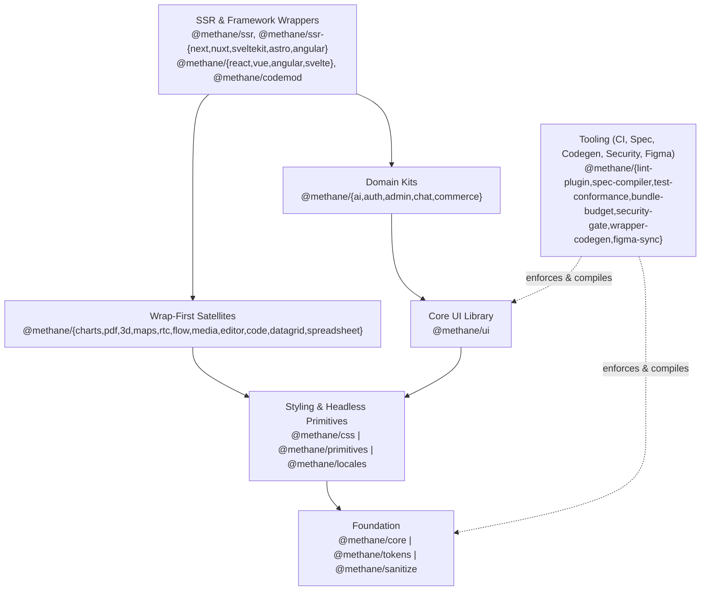

# Methane UI

[](https://opensource.org/licenses/MIT)

Accessible UI components, pure CSS layouts, adaptive OKLCH themes, and streaming Declarative Shadow DOM SSR that work across **HTML**, **React**, **Vue**, **Angular**, and **Svelte** — built on **Lit 3**, **ElementInternals**, and **`@lit/context`**.

**Live Documentation & Theme Studio:** [https://mahdins.dev/methane/](https://mahdins.dev/methane/)

## Why Methane UI?

- **Universal & Standards-First**: Built once on Web Components + Lit 3, with first-class typed integrations for **HTML**, **React 19 / React 18**, **Vue 3**, **Angular 17+**, and **Svelte 5** generated from a single `custom-elements.json` + `ComponentBehaviorSpec` source of truth.
- **Per-Component Tree Shaking**: Import `@methane/ui/button` (auto-registers `<mth-button>`) or `@methane/ui/button/element` (`registerMthButton('acme')` for custom white-label tag prefixes).
- **True Form Participation & Same-Root ARIA**: Native Form-Associated Custom Elements (`ElementInternals`), `CustomStateSet` (`:state(...)`), and `FIELD_CONTEXT` / `FORM_CONTEXT` so labels, hints, errors, and validation remain in the same accessibility tree.
- **Pure CSS Layouts & Progressive Enhancement**: `@methane/css` delivers ordered `@layer` rules, fail-open `:not(:defined)` FOUC protection, and lightweight CSS layout, prose, form, and marketing classes without JavaScript overhead.
- **Streaming DSD SSR Across Every Meta-Framework**: Wraps `@lit-labs/ssr` with hybrid linked + compact critical inline style delivery and adapters for **Next.js**, **Nuxt**, **SvelteKit**, **Astro**, and **Angular SSR**.
- **Perceptual `oklch()` Theming**: Single-seed brand overrides, automatic `light-dark()`, density presets (`compact`, `default`, `comfortable`), `prefers-reduced-motion`, and Windows `forced-colors` support.
- **Defense-in-Depth Security**: `@methane/sanitize` combines native `Element.prototype.setHTML` with DOMPurify parity, URL protocol allowlisting, Trusted Types compatibility, and strict CSP auditing.

## AI Agent Skills

Methane includes curated agent skills under [`skills/`](./skills) (with workspace discovery via [`.agents/skills.json`](./.agents/skills.json)) for **Antigravity**, **Claude Code**, **Cursor**, **Codex**, and **Gemini CLI**:

```bash
npx skills add MehdiNosrati/methane
```

| Skill | Focus |
| --- | --- |
| [`methane-ui`](./skills/methane-ui/SKILL.md) | Pure CSS layouts vs. custom elements, domain kits, satellites, `FormData`, and framework patterns |
| [`methane-theming`](./skills/methane-theming/SKILL.md) | OKLCH brand seeds, light/dark & density presets, `forced-colors`, DTCG `tokens.json`, and `::part()` / `:state()` |
| [`methane-ssr`](./skills/methane-ssr/SKILL.md) | Declarative Shadow DOM SSR, FOUC protection, lazy satellite engines, and client hydration order |
| [`methane-contribute`](./skills/methane-contribute/SKILL.md) | Contributor runbook for component specs, same-root ARIA, logical CSS, codegen, and E2E tests |

## Architecture



## Packages

### Foundation & Styling

| Package | Path | Description |
| --- | --- | --- |
| [`@methane/tokens`](./packages/tokens/README.md) | `packages/tokens` | W3C DTCG tokens, `oklch()` color scales, `light-dark()` themes, density & forced-colors CSS + compiler |
| [`@methane/sanitize`](./packages/sanitize/README.md) | `packages/sanitize` | Native `setHTML` + DOMPurify parity HTML/Markdown/streaming sanitizer & URL validator |
| [`@methane/core`](./packages/core/README.md) | `packages/core` | Lit 3 `UIElement` base class, versioned `globalThis` runtime coordinator, i18n, and `@lit/context` tokens |
| [`@methane/primitives`](./packages/primitives/README.md) | `packages/primitives` | ReactiveControllers (overlay, positioning, focus trap, roving focus, masks, virtualizer), `AutoLoader`, utility elements |
| [`@methane/css`](./packages/css/README.md) | `packages/css` | Ordered `@layer` reset, fail-open `:not(:defined)` guard, and pure-CSS layout, prose, form, and marketing classes |
| [`@methane/locales`](./packages/locales/README.md) | `packages/locales` | Code-split lazy locale packs (`en`, `es`, `fr`, `de`, `ja`, `zh-CN`, `ar`, `he`) with `Intl.PluralRules` & RTL |

### Core UI

| Package | Path | Description |
| --- | --- | --- |
| [`@methane/ui`](./packages/ui/README.md) | `packages/ui` | Accessible, form-associated, tree-shakeable Lit 3 core UI Web Components |

### Domain Kits

| Package | Path | Description |
| --- | --- | --- |
| [`@methane/ai`](./packages/kits/ai/README.md) | `packages/kits/ai` | AI/LLM UX components (`mth-prompt-input`, `mth-ai-message`, `mth-thinking-indicator`, `mth-tool-call`, `mth-artifact-pane`, …) |
| [`@methane/auth`](./packages/kits/auth/README.md) | `packages/kits/auth` | Authentication & RBAC components (`mth-auth-form`, `mth-mfa-challenge`, `mth-passkey-prompt`, `mth-sso-buttons`, …) |
| [`@methane/admin`](./packages/kits/admin/README.md) | `packages/kits/admin` | Enterprise dashboard components (`mth-kanban`, `mth-audit-log`, `mth-filter-builder`, `mth-csv-importer`, `mth-settings-shell`, …) |
| [`@methane/chat`](./packages/kits/chat/README.md) | `packages/kits/chat` | Real-time collaboration components (`mth-chat-thread`, `mth-message-composer`, `mth-notification-bell`, `mth-reaction-bar`, …) |
| [`@methane/commerce`](./packages/kits/commerce/README.md) | `packages/kits/commerce` | Storefront & billing components (`mth-product-card`, `mth-cart`, `mth-payment-form`, `mth-plan-picker`, `mth-invoice`, …) |

### Wrap-First Satellites (Layer 3b)

| Package | Path | Description |
| --- | --- | --- |
| [`@methane/charts`](./packages/satellites/charts/README.md) | `packages/satellites/charts` | Apache ECharts declarative charts (`mth-chart`, `mth-chart-series`) with accessible fallback tables |
| [`@methane/pdf`](./packages/satellites/pdf/README.md) | `packages/satellites/pdf` | Mozilla `pdfjs-dist` accessible document viewer (`mth-pdf-viewer`) with search, outline, zoom & keyboard navigation |
| [`@methane/3d`](./packages/satellites/3d/README.md) | `packages/satellites/3d` | Three.js lazy WebGL/WebGPU 3D viewer (`mth-model-viewer`) with poster fallback & deterministic GPU cleanup |
| [`@methane/maps`](./packages/satellites/maps/README.md) | `packages/satellites/maps` | MapLibre GL JS & SVG spatial components (`mth-map`, `mth-map-route`, `mth-map-draw`, `mth-floor-plan`, `mth-seat-map`, …) |
| [`@methane/rtc`](./packages/satellites/rtc/README.md) | `packages/satellites/rtc` | WebRTC, `MediaDevices`, and `MediaRecorder` components (`mth-audio-recorder`, `mth-camera-capture`, `mth-screen-recorder`, `mth-video-grid`) |
| [`@methane/flow`](./packages/satellites/flow/README.md) | `packages/satellites/flow` | `@dagrejs/dagre` interactive node/DAG editor (`mth-flow-editor`) and organization chart (`mth-org-chart`) |
| [`@methane/media`](./packages/satellites/media/README.md) | `packages/satellites/media` | `@lottiefiles/dotlottie-web` player (`mth-lottie`), audio waveform (`mth-waveform`), and SVG `mth-image-annotator` |
| [`@methane/editor`](./packages/satellites/editor/README.md) | `packages/satellites/editor` | ProseMirror rich editor, Markdown preview/editor, and KaTeX math editor (`mth-rich-editor`, `mth-markdown`, `mth-math-editor`) |
| [`@methane/code`](./packages/satellites/code/README.md) | `packages/satellites/code` | CodeMirror 6 editor (`mth-code-editor`), syntax-highlighted `mth-code-block`, `mth-diff-viewer`, and `mth-json-editor` |
| [`@methane/datagrid`](./packages/satellites/datagrid/README.md) | `packages/satellites/datagrid` | TanStack Table & Virtual Core `mth-datagrid`, `mth-pivot-table`, `mth-tree-table`, `mth-scheduler`, `mth-gantt` |
| [`@methane/spreadsheet`](./packages/satellites/spreadsheet/README.md) | `packages/satellites/spreadsheet` | Virtualized `mth-spreadsheet` & `mth-formula-bar` with clean-room MIT Formula AST evaluator |

### SSR Adapters

| Package | Path | Description |
| --- | --- | --- |
| [`@methane/ssr`](./packages/ssr/README.md) | `packages/ssr` | Streaming DSD SSR engine (`@lit-labs/ssr` + hybrid linked/inline CSS delivery, `dom-shim`, `@methane/ssr/client`) |
| [`@methane/ssr-next`](./packages/ssr-next/README.md) | `packages/ssr-next` | Next.js App Router & RSC streaming DSD adapter + `@methane/ssr-next/client` hydration |
| [`@methane/ssr-nuxt`](./packages/ssr-nuxt/README.md) | `packages/ssr-nuxt` | Nuxt 3 / Nitro server plugin + `@methane/ssr-nuxt/client` Vue plugin |
| [`@methane/ssr-sveltekit`](./packages/ssr-sveltekit/README.md) | `packages/ssr-sveltekit` | SvelteKit `handle` hook + `@methane/ssr-sveltekit/client` hydration |
| [`@methane/ssr-astro`](./packages/ssr-astro/README.md) | `packages/ssr-astro` | Astro integration, renderer, middleware + `@methane/ssr-astro/client` island hydration |
| [`@methane/ssr-angular`](./packages/ssr-angular/README.md) | `packages/ssr-angular` | Angular SSR serialization + `@methane/ssr-angular/client` (`provideMethaneHydration()`) |

### Framework Wrappers & Migration

| Package | Path | Description |
| --- | --- | --- |
| [`@methane/react`](./packages/react/README.md) | `packages/react` | React 19 native Custom Elements JSX types + React 18 `@lit/react` wrappers (`@methane/react/legacy`) |
| [`@methane/vue`](./packages/vue/README.md) | `packages/vue` | Typed Vue 3 `defineComponent` wrappers with `v-model` & compiler options (`METHANE_VUE_COMPILER_OPTIONS`) |
| [`@methane/angular`](./packages/angular/README.md) | `packages/angular` | Standalone Angular 17+ directives with `ControlValueAccessor` form support (`METHANE_ANGULAR_DIRECTIVES`) |
| [`@methane/svelte`](./packages/svelte/README.md) | `packages/svelte` | Svelte 5 runes (`$bindable()`) wrapper components (`@methane/svelte/*.svelte`) & element types |
| [`@methane/codemod`](./packages/codemod/README.md) | `packages/codemod` | Idempotent AST codemod CLI (`methane-codemod`) for tag/token white-labeling and manifest migrations |

### Tooling

| Package | Path | Description |
| --- | --- | --- |
| [`@methane/lint-plugin`](./tooling/lint-plugin/README.md) | `tooling/lint-plugin` | ESLint & Stylelint architectural invariant rules (XSS sinks, logical CSS, Shadow DOM focus/ARIA checks) |
| [`@methane/spec-compiler`](./tooling/spec-compiler/README.md) | `tooling/spec-compiler` | `ComponentBehaviorSpec` validator, Markdown docs compiler, CEM verifier & a11y checklist generator |
| [`@methane/test-conformance`](./tooling/test-conformance/README.md) | `tooling/test-conformance` | `FormControlSuite`, `OverlaySuite`, `RovingFocusSuite`, `SatelliteEngineSuite`, `HydrationPuritySuite`, `scanSameRootAria` |
| [`@methane/bundle-budget`](./tooling/bundle-budget/README.md) | `tooling/bundle-budget` | Cold standalone & marginal brotli/gzip bundle budget measurement (`esbuild` + `node:zlib`) |
| [`@methane/security-gate`](./tooling/security-gate/README.md) | `tooling/security-gate` | Strict CSP + Trusted Types compliance suite, DSD HTML CSP audit, license audit & CI workflow gate |
| [`@methane/wrapper-codegen`](./tooling/wrapper-codegen/README.md) | `tooling/wrapper-codegen` | CEM + BehaviorSpec code generator CLI (`methane-wrapper-codegen`) for React, Vue, Angular, Svelte & IDEs |
| [`@methane/figma-sync`](./tooling/figma-sync/README.md) | `tooling/figma-sync` | Two-way Figma Variables REST API ↔ W3C DTCG token sync (`oklch()`) & `@figma/code-connect` generator |

## Multi-Framework Quickstart

### Vanilla HTML / TypeScript

```html
<mth-stack data-gap="4">
  <mth-field label="Workspace Name">
    <mth-input name="workspace" placeholder="acme-prod" required></mth-input>
  </mth-field>
  <mth-button variant="solid">Create Workspace</mth-button>
</mth-stack>

<script type="module">
  import '@methane/tokens/tokens.css';
  import '@methane/css/index.css';
  import '@methane/ui/button';
  import '@methane/ui/field';
  import '@methane/ui/input';
</script>
```

### React 19 (and React 18 Legacy)

```tsx
import '@methane/tokens/tokens.css';
import '@methane/ui/button';
import '@methane/ui/input';
import '@methane/react'; // React 19 JSX IntrinsicElements
// For React 18: import { MthButton, MthInput } from '@methane/react/legacy';

export function QuickForm() {
  return (
    <mth-form>
      <mth-input name="email" type="email" required />
      <mth-button type="submit" variant="solid">Subscribe</mth-button>
    </mth-form>
  );
}
```

### Vue 3

```vue
<script setup lang="ts">
import '@methane/tokens/tokens.css';
import '@methane/ui/button';
import '@methane/ui/input';
import { ref } from 'vue';
import { MthButton, MthInput } from '@methane/vue';

const email = ref('');
</script>

<template>
  <MthInput v-model="email" type="email" placeholder="you@example.com" />
  <MthButton variant="solid">Continue</MthButton>
</template>
```

### Angular 17+

```ts
import { Component, CUSTOM_ELEMENTS_SCHEMA } from '@angular/core';
import { FormControl, ReactiveFormsModule } from '@angular/forms';
import '@methane/tokens/tokens.css';
import '@methane/ui/button';
import '@methane/ui/input';
import { MthButtonDirective, MthInputDirective } from '@methane/angular';

@Component({
  standalone: true,
  schemas: [CUSTOM_ELEMENTS_SCHEMA],
  imports: [ReactiveFormsModule, MthButtonDirective, MthInputDirective],
  template: `
    <mth-input [formControl]="email" type="email"></mth-input>
    <mth-button variant="solid">Save</mth-button>
  `,
})
export class ProfileComponent {
  email = new FormControl('', { nonNullable: true });
}
```

### Svelte 5

```svelte
<script lang="ts">
  import '@methane/tokens/tokens.css';
  import '@methane/ui/button';
  import '@methane/ui/input';
  import MthButton from '@methane/svelte/MthButton.svelte';
  import MthInput from '@methane/svelte/MthInput.svelte';

  let name = $state('');
</script>

<MthInput bind:value={name} placeholder="Display name" />
<MthButton variant="solid">Save {name}</MthButton>
```

### SSR & Client Hydration (Next.js / Astro / Universal)

Client Declarative Shadow DOM hydration is opt-in via `@methane/core/hydrate` (for standalone `@methane/core` / Lit apps) or `@methane/ssr/client` (plus framework adapters `@methane/ssr-next/client`, `@methane/ssr-nuxt/client`, `@methane/ssr-sveltekit/client`, `@methane/ssr-astro/client`, `@methane/ssr-angular/client`) provide explicit hydration sequencing helpers:

```ts
// Next.js App Router ("use client")
import { initNextHydration } from '@methane/ssr-next/client';
initNextHydration();
await import('@methane/ui/button'); // Declarative Shadow DOM elements upgrade in place
```

```ts
// Astro integration (astro.config.mjs)
import { defineConfig } from 'astro/config';
import { createMethaneAstroIntegration } from '@methane/ssr-astro';

export default defineConfig({
  integrations: [createMethaneAstroIntegration({ styles: 'linked' })],
});
```

## OKLCH 4-Tier Theming Guide

Methane UI derives perceptual color ramps and semantic tokens in `oklch()` across four cascade tiers inside `@layer mth.tokens`:

```css
@import '@methane/css/layers.css';
@import '@methane/tokens/tokens.css';
@import '@methane/css/index.css';

/* Tier 1: Override brand seed on :root to regenerate semantic accents */
:root {
  --mth-color-seed-brand: oklch(0.58 0.22 258);
}

/* Tier 3: Or customize individual semantic roles & radii */
[data-mth-theme='dark'] {
  --mth-color-bg: oklch(0.14 0.01 260);
  --mth-color-surface: oklch(0.18 0.015 260);
}

/* Tier 4: Scope density or customize internal Shadow DOM parts */
.compact-toolbar {
  --mth-density: 0.8;
}
mth-button::part(base) {
  letter-spacing: 0.01em;
}
```

Use `data-mth-theme="light" | "dark"` (or `.mth-theme-*`) and `data-mth-density="compact" | "default" | "comfortable"` (or `.mth-density-*`) anywhere in the DOM subtree.

## Monorepo Development Commands

Prerequisites: **Node.js >= 22**, **pnpm >= 10**.

```bash
# Install workspace dependencies
pnpm install

# Build all packages, apps, and tooling
pnpm build

# Run TypeScript typechecking across the workspace
pnpm typecheck

# Run ESLint & Stylelint checks (including @methane/lint-plugin invariants)
pnpm lint

# Run all Vitest unit and conformance suites
pnpm test

# Run Playwright browser end-to-end tests (playwright.config.ts)
pnpm test:e2e
# or directly via Playwright CLI
pnpm exec playwright test
```

## License

MIT © [Methane UI](https://mahdins.dev/methane/)
